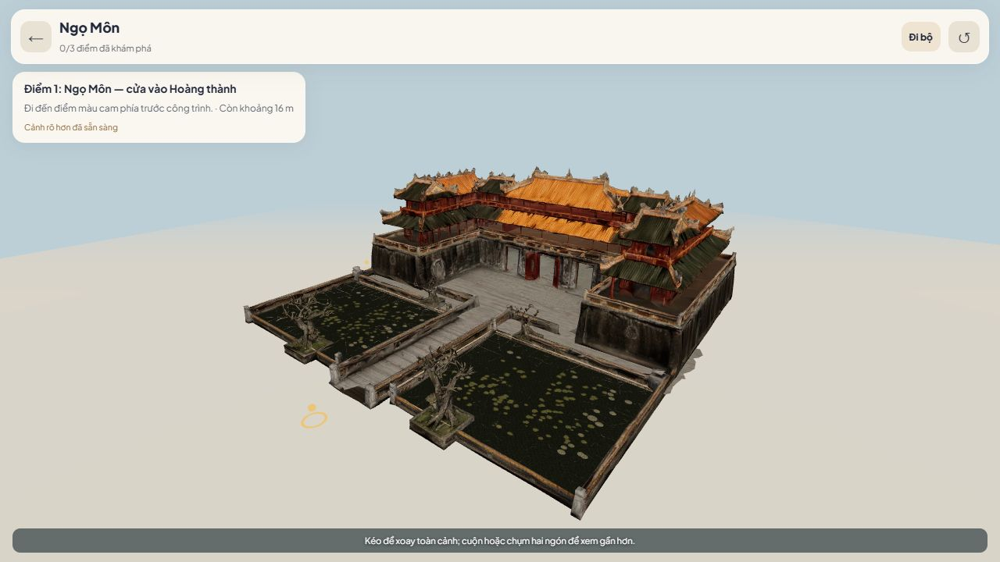
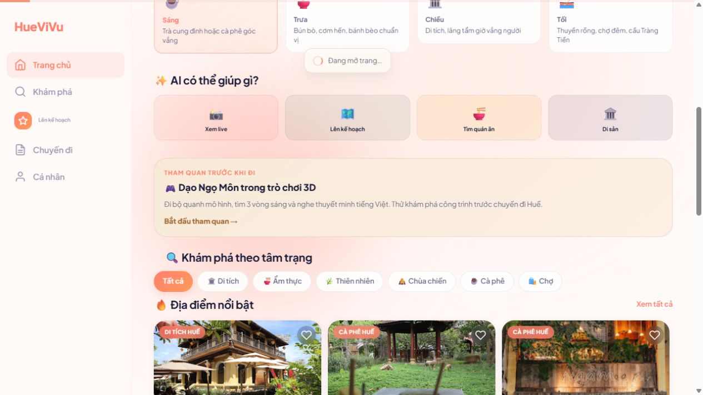

# Ngọ Môn 3D và trải nghiệm chờ tải — 07/10/2026

Phạm vi local: http://localhost:3000. Mô hình hiện có là Ngọ Môn; chưa có mô hình toàn bộ Đại Nội.

## Bản chơi

- Tải cảnh nhẹ trước, có thể đi bộ trong khi cảnh rõ hơn tải nền.
- Góc nhìn theo mặt đất, tầm mắt 1,65 đơn vị trong cảnh được chỉnh tỷ lệ; đây là mô phỏng, không phải bản đo đạc kiến trúc.
- Đi bằng W A S D, phím mũi tên, nút giữ trên điện thoại; kéo cảnh để nhìn quanh. Có toàn cảnh và nút về điểm bắt đầu.
- Va chạm dùng mô hình riêng, chặn cả hai phía của tường scan; cửa còn mở có thể đi qua. Chia chuyển động thành bước nhỏ để tránh xuyên tường.
- Vòng xanh chỉ tuyến vòng ngoài, điểm màu cam mở ba thuyết minh. Có tùy chọn tự đi theo lối, dừng khi tới điểm hoặc khi người dùng tự điều khiển.
- Ba bản đọc tiếng Việt được lưu trong ứng dụng, có tạm dừng, đọc tiếp và nghe lại. Mở thuyết minh sẽ dừng chuyển động.
- Trang chủ có đường vào trò chơi. Đã bỏ các nút AR/gắn điểm vốn chưa hoạt động.

## Tài nguyên

| Loại | Dung lượng | Tam giác tính cả các phần được dùng lại |
|---|---:|---:|
| Mô hình nén trước đây | khoảng 21,6 MiB | 9.303.776 |
| Cảnh mở đầu | khoảng 1,19 MiB | 112.006 |
| Cảnh rõ hơn | khoảng 5,07 MiB | 232.591 |
| Mô hình va chạm | khoảng 70,7 KiB | 9.258 |

Ảnh bề mặt cảnh rõ hơn giữ ở 2048 px, được xử lý từ mô hình gốc 4096 px thay vì nén tiếp bản 1024 px đã mờ. Bản gốc được giữ nguyên. Chi tiết hoặc phần bị thiếu trong bản scan không được tự dựng thành công trình lịch sử khác.

`public/models/ngo-mon-game-info.json` ghi thống kê. Các file GLB và MP3 dùng Git LFS; máy triển khai phải lấy dữ liệu LFS thật, không phục vụ file con trỏ.

```powershell
npm run 3d:prepare
# Máy chủ local phải chạy khi chuẩn bị lại giọng đọc:
npm run 3d:audio
npm run test:3d
```

Giọng đọc được tạo từ các mô tả công khai đã biên soạn qua endpoint TTS hiện có; lúc người dùng nghe chỉ tải MP3 local. Nguồn nội dung: [Cục Di sản văn hóa](https://dsvh.gov.vn/di-tich-lich-su-va-kien-truc-nghe-thuat-quan-the-kien-truc-co-do-hue-2944).

## Kiểm tra hiện tại

Kiểm tra vật lý đạt: tầm mắt/mặt đất, trọng lực, tốc độ chéo, quay lại tab, tường mỏng hai phía, lối cửa, đường đi tới đủ ba điểm trên chính dữ liệu va chạm, giới hạn tài nguyên và ba file ghi âm. Trình duyệt đã kiểm tra đi thủ công, bị chặn bởi vật cản, phát/dừng/đọc tiếp/nghe lại; đi hết cả ba điểm theo tuyến, mở từng thuyết minh và xác nhận trạng thái **3/3**. Đã kiểm tra ở viewport 390×844; chưa đo FPS trên điện thoại vật lý.




## Loading toàn ứng dụng

Cần phân biệt ba giai đoạn: nhận trang ban đầu, chuyển trang, và tải dữ liệu/mô hình bên trong trang. Spinner hoặc thanh chạy là chỉ báo chờ, không phải phần trăm hoàn thành. Phần trăm chỉ dùng khi biết số byte tải thực tế, như các file 3D.

Tài liệu đã đối chiếu với Next.js đang cài 15.5.27: [loading.tsx và Suspense](https://nextjs.org/docs/app/api-reference/file-conventions/loading), [onRouterTransitionStart](https://nextjs.org/docs/app/api-reference/file-conventions/instrumentation-client). Chỉ báo trong ứng dụng không thể xuất hiện trước khi trình duyệt nhận HTML đầu tiên; cần đánh giá thời gian đó bằng bản production đã build.

Đã triển khai:

- Màn chờ trong HTML ban đầu, có spinner/nhãn HueViVu, tự tắt sau khi trình duyệt tải trang và React sẵn sàng. Khi chờ lâu có đường tải lại bằng HTML thông thường.
- `loading.tsx` cấp ứng dụng; trạng thái chờ trong nhóm trang chính có giải thích thay vì chỉ có khung trống.
- Chỉ báo chuyển trang dùng callback được hỗ trợ của Next, có thanh chạy và thông báo. Khi chờ quá 12 giây có gợi ý kiểm tra kết nối và thử mở lại. Theo dõi cả `push`, `replace`, back/forward và query; bỏ qua thao tác chỉ đổi hash.
- Cập nhật chỉ báo ở ngoài React navigation transition để phản hồi xuất hiện trước khi trang mới tải xong; kết thúc theo URL đã commit, tránh một lần chuyển trang cũ tắt chỉ báo của yêu cầu mới.
- Không dùng phần trăm giả cho việc chuyển trang; không đặt thời gian chờ tối thiểu. Có chế độ giảm chuyển động theo thiết lập thiết bị.

Kiểm tra loading: HTML lần mở đầu có nhãn/hiệu ứng chờ, sau khi tải xong tự tắt. Đã mô phỏng mạng chậm và quan sát chỉ báo “Đang mở trang…” xuất hiện ngay sau bấm, rồi biến mất khi trang mới sẵn sàng. Trạng thái chờ nội dung của từng trang có giải thích và đường tải lại khi kéo dài. Thiết lập mạng mô phỏng đã được khôi phục.



Bản sản xuất đã build và smoke suite đạt 22/22. Còn cảnh báo font hiện hữu; chưa kiểm tra FPS/âm lượng trên thiết bị vật lý và chưa triển khai máy chủ công khai. Root loading không thay thế các kiểm tra khả năng chịu tải hoặc thời gian máy chủ bắt đầu trả HTML.

Kiểm tra cuối: TypeScript đạt, kiểm tra vật lý đạt, build đạt và smoke 22/22; audit thư viện production: 0 lỗ hổng. Máy chủ local chạy tại cổng 3000 bằng tiến trình nền, không mở cửa sổ terminal. Không phát hiện lỗi console khi xem cảnh 3D của bản production. Không tự xác nhận độ chính xác kiến trúc của bản scan ngoài nội dung mà chủ dự án cung cấp.
