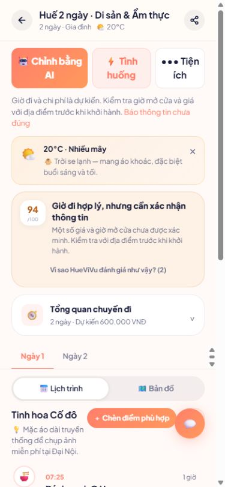
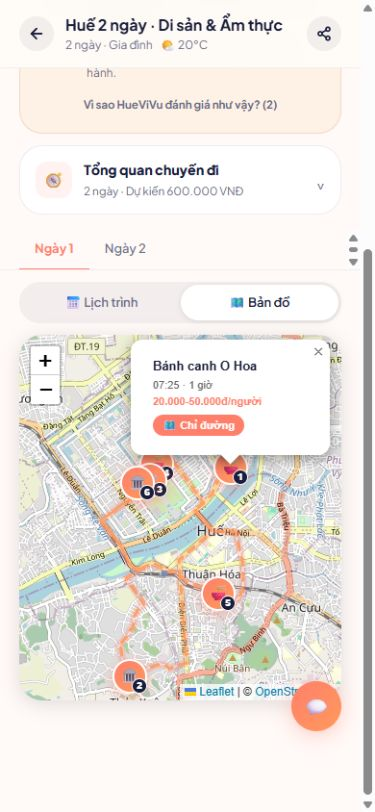

# HueViVu — kiểm tra trước dùng thử ngày 07/10/2026

Phạm vi: dự án local tại **http://localhost:3000**. Chưa triển khai thay đổi lên máy chủ hiện tại hoặc landing page huevivu.id.vn.

## Quyết định mở thử

Ưu tiên nhóm nhỏ, có người hỗ trợ và thu phản hồi. Chưa kết luận đủ điều kiện công bố rộng rãi chỉ từ kiểm tra local. Cần kiểm tra môi trường thật và dữ liệu thực tế trước khi mời người dùng đi theo lịch.

## Các vấn đề đã xử lý

- Khóa cả hai đường đăng nhập demo và mật khẩu demo công khai; tài khoản demo cũ không còn quyền quản trị, token của nó bị từ chối.
- Khách được cấp danh tính ngẫu nhiên trên máy chủ; mã analytics do trình duyệt gửi không thể lấy lại danh tính khách khác.
- Bản sản xuất cần JWT_SECRET ít nhất 32 ký tự. Khóa local đã được tạo trong `.env.local`, không đưa vào Git.
- Kiểm tra đầu vào lịch trình; token hết hạn không âm thầm chuyển sang khách mới.
- Chặn bấm liên tiếp làm nhảy câu hỏi/tạo lịch trùng; giữ lựa chọn khi lỗi để thử lại.
- Điều chỉnh vì đi trễ/mưa/mệt có xem trước, trước/sau, xác nhận hoặc hủy; từ chối áp dụng khi lịch lưu đã thay đổi.
- Không báo đã lùi lịch khi ngày không còn hoạt động để đổi; hộp xem trước cuộn được trên điện thoại.
- Bộ điều chỉnh chỉ chọn địa điểm đã công bố.
- Trang chủ/tìm kiếm có phục hồi khi tải lỗi; có trang lỗi và không tìm thấy bằng tiếng Việt.
- Góp ý chỉ báo thành công khi máy chủ đã lưu; lỗi giữ nội dung để gửi lại. Hướng dẫn không hứa khả năng mở lại lịch offline hoặc trả lời email tự động.
- Ngừng tạo nhiệt độ/dự báo giả khi nguồn thời tiết mất kết nối; lấy thời tiết lúc chạy thay vì đóng băng lúc build.
- Giải thích thông tin chưa xác minh và chi phí/giờ dự kiến; sửa mô tả quyền riêng tư/camera cho khớp hành vi thật.
- Điểm thời gian cao không còn đồng nghĩa với thông tin đã xác minh; từng ngày nêu lý do cần kiểm tra giá/giờ. Khi thiếu cấu hình nhận diện, Live Guide nói rõ chưa nhận diện được ảnh, chỉ gợi ý từ danh mục.
- Nâng Next.js lên 15.5.27, đồng bộ React và thư viện bản đồ/3D, vá PostCSS. Build không bỏ qua lỗi kiểu dữ liệu hoặc lint.
- Thêm health check, sao lưu SQLite có kiểm tra tính toàn vẹn, lệnh thiết lập quản trị cá nhân và icon manifest.

## Dữ liệu và giới hạn

Có 14 địa điểm công bố: 6 ẩm thực, 4 cà phê, 3 di sản, 1 thiên nhiên. Cả 14 hiện có trạng thái xác minh `draft`; không tự đổi thành đã xác minh. Rà soát tên, địa chỉ, tọa độ, giá, giờ mở cửa và nguồn với người phụ trách trước khi quảng bá khả năng dẫn chuyến thực tế. Danh mục nhỏ khiến lịch dài có thể lặp quán ăn; chưa phù hợp để hứa hẹn 5–7 ngày trải nghiệm phong phú.

Chưa có tài khoản quản trị cá nhân trong dữ liệu hiện tại. Chủ sản phẩm cần đăng ký tài khoản riêng rồi cấp quyền từ máy chủ bằng lệnh bên dưới. Không khôi phục demo làm quản trị.

Local chưa cấu hình khóa dịch vụ AI khi kiểm tra. Tạo lịch theo bộ lập lịch và gợi ý dữ liệu vẫn hoạt động; nhận diện ảnh/câu trả lời AI trực tiếp cần kiểm tra riêng sau khi cấu hình. Chưa có phục hồi mật khẩu qua email.

Phần 3D đã có bản chơi khu Ngọ Môn, mô hình nhẹ, va chạm, ba thuyết minh tiếng Việt và tuyến đi tới đủ ba điểm. Xem [kiểm tra 3D và loading](3D_AND_LOADING.md). Chưa có mô hình toàn bộ Đại Nội hoặc đo FPS trên điện thoại vật lý. Chưa đo khả năng chịu tải của máy chủ thật. Kiểm tra thư viện sản xuất hiện không báo lỗ hổng; bộ công cụ phát triển còn các cảnh báo cần xử lý riêng.

## Chạy tại local

```powershell
npm ci
npm run build
npm run start -- --port 3000
```

Không chạy dev và build chung `.next` cùng lúc. Khi phát triển, dừng bản start rồi chạy `npm run dev -- --port 3000`.

```powershell
npm run test:types
npm run lint
$env:TEST_BASE_URL = 'http://localhost:3000'
npm run test:smoke
npm audit --omit=dev
npm run db:backup
npm run admin:set -- email-tai-khoan-da-dang-ky@example.com
```

Smoke suite tạo và dọn dữ liệu kiểm thử của riêng nó. Chạy với máy chủ local và SQLite cùng workspace; không trỏ suite local vào máy chủ thật vì fixture quản trị được thiết lập trực tiếp trong SQLite local.

`GET /api/health` trả 200 khi cấu hình xác thực, kết nối dữ liệu và danh mục công bố sẵn sàng; trả 503 khi chưa sẵn sàng. Nó không chứng nhận độ chính xác nội dung, AI hoặc khả năng chịu tải.

## Trước khi đưa bản này lên máy chủ

1. Sao lưu bằng `npm run db:backup`, giữ bản sao ngoài máy chủ. Không chỉ copy `.db` khi ứng dụng đang dùng WAL; dùng bản sao lưu đã kiểm tra. WAL/SHM là dữ liệu chạy, không phân phối qua Git. Repository trước đây theo dõi WAL/SHM bằng LFS; loại chúng khỏi phiên bản triển khai.
2. Cấu hình khóa JWT riêng trên máy chủ, SQLite bền vững và tài khoản quản trị cá nhân. Không dùng khóa local cho máy chủ thật.
3. Phục vụ ứng dụng qua HTTPS. IP hiện được cung cấp qua HTTP; kiểm tra camera/vị trí trên thiết bị thật và truyền mật khẩu trên URL HTTPS trước khi mời người dùng.
4. Chạy production với cổng nội bộ 3000, kiểm tra health, log lỗi, điện thoại và đường đi từ nút Bắt đầu hành trình của landing page.
5. Kiểm thử: vào lần đầu → tạo lịch → mở lại → xem điểm → xem trước điều chỉnh → hủy → áp dụng → gửi phản hồi. Kiểm tra từ chối camera/vị trí, mất mạng và phiên hết hạn.
6. Mời nhóm nhỏ có đầu mối hỗ trợ; theo dõi lỗi 500, thời gian tạo lịch, người bị mắc kẹt và phản hồi sai giờ/giá. Có thể dừng mời thêm hoặc quay lại mã nguồn bản trước; không ghi đè dữ liệu mới bằng bản sao cũ.

## Bằng chứng kiểm tra

- `npm run build`: đạt; có kiểm tra TypeScript và lint. Còn cảnh báo tối ưu ảnh/font, không có lỗi chặn build.
- `npm run test:types` và `npm run lint`: đạt.
- Smoke suite trên **http://localhost:3000**: **22 đạt, 0 lỗi**. Bao gồm xác thực/quyền, dữ liệu bản nháp, lịch riêng tư, replay phiên khách, đầu vào sai, xem trước/xác nhận/xung đột, trường hợp không có thay đổi, lịch 1/3/5/7 ngày và phản hồi.
- `npm audit --omit=dev`: **0 lỗ hổng** trong các thư viện sản xuất. Không đồng nghĩa đã đánh giá mọi rủi ro bảo mật của ứng dụng.
- SQLite `integrity_check`: **ok**, 14 địa điểm được giữ nguyên. Không còn tài khoản smoke sau khi dọn fixture.
- Bản sao lưu mới nhất đã kiểm tra: `backups/huevivu-2026-10-06T16-39-17-530Z.db`. Đây là dữ liệu riêng, không đưa lên Git.
- Trình duyệt tại kích thước 390×844: tạo lịch gia đình hai ngày, phục hồi phiên hết hạn, mở lại lịch đã lưu, xem trước và hủy, thông báo không có thay đổi, mở bản đồ và chạm marker, mở kênh góp ý.
- Tắt máy chủ local để thử gửi góp ý: có thông báo lỗi, nội dung giữ nguyên; khởi động lại và gửi lại: thành công, máy chủ lưu đúng một phản hồi. Phản hồi kiểm thử đã được dọn.
- Không thấy lỗi console khi kiểm tra bản đồ; chiều rộng tài liệu không vượt viewport trong trang lịch.
- Chưa kiểm chứng bằng điện thoại vật lý, camera/microphone thật hoặc máy chủ công khai. Việc áp dụng điều chỉnh được kiểm tra qua API; giao diện đã kiểm tra xem trước/hủy và trạng thái không có thay đổi.





Nguồn cho bản vá nền tảng: [thông báo bảo mật Next.js trên Windows](https://github.com/vercel/next.js/security/advisories/GHSA-p293-qw3h-jr36), [hướng dẫn nâng cấp Next.js 15](https://nextjs.org/docs/app/guides/upgrading/version-15).
